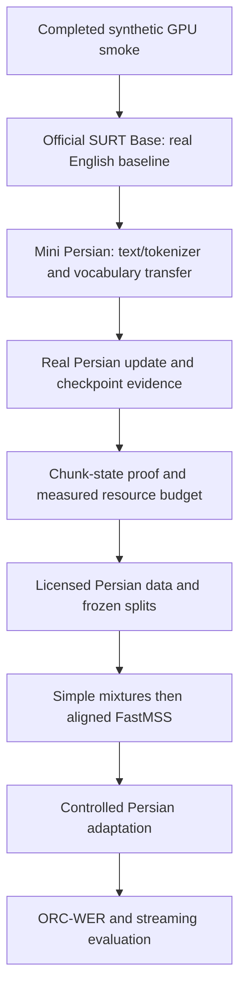

# Active dependencies — Persian SURT adaptation

Updated 2026-11-20: real English 1A, mini Persian technical 1B and bounded
full-model streaming technical 1C are accepted. The 1C-B review uses
`outputs/streamb-20261120-a/`; see [feasibility evidence](PERSIAN_SURT_FEASIBILITY.md).
Stage 2 pilot-data preparation is next, but only its prompt has been prepared;
implementation/experiments await the user's explicit instruction. Restore saved
1B inputs when needed; completed phases need not be rerun.

The current native-export wrappers are an optional integration path. Missing
local exports do not block the upstream real-speech baseline. The upstream 1C-B adapters have actual chunk-state evidence; live deployment
and real long-conversation quality still require their own evaluation. Generic
VAD/OSD diagnostics are not prerequisites. See [roadmap](PERSIAN_SURT_ROADMAP_FA.md).
