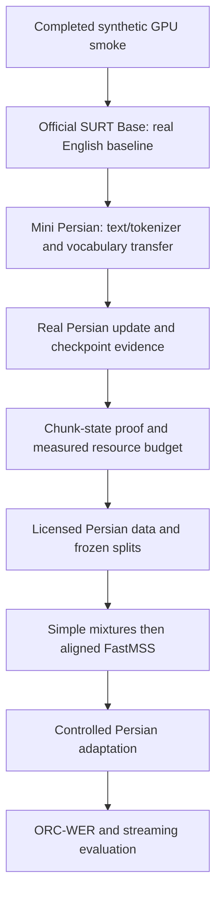

# Active dependencies — Persian SURT adaptation

The current native-export wrappers are an optional integration path. Missing
local exports do not block the upstream real-speech baseline. Actual chunk-state
engineering remains necessary before claiming incremental streaming. Generic
VAD/OSD diagnostics are not prerequisites. See [roadmap](PERSIAN_SURT_ROADMAP_FA.md).
