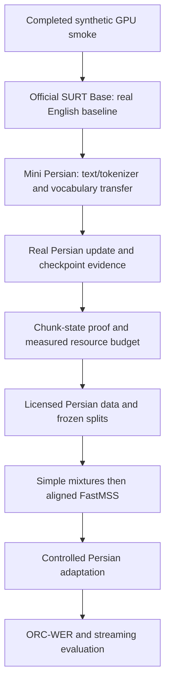

# Active dependencies — Persian SURT adaptation

Updated 2026-11-19: real English 1A and the technical mini Persian 1B gate are
accepted. Native streaming remains open. Start with [1C-A](KAGGLE_SURT_STREAMING_RUNBOOK_FA.md)
for exact API/source and component/resource evidence, then complete native state
integration and end-to-end parity in 1C-B. Restore saved 1B inputs after a session
reset; rerunning the completed phases is unnecessary.

The current native-export wrappers are an optional integration path. Missing
local exports do not block the upstream real-speech baseline. Actual chunk-state
engineering remains necessary before claiming incremental streaming. Generic
VAD/OSD diagnostics are not prerequisites. See [roadmap](PERSIAN_SURT_ROADMAP_FA.md).
