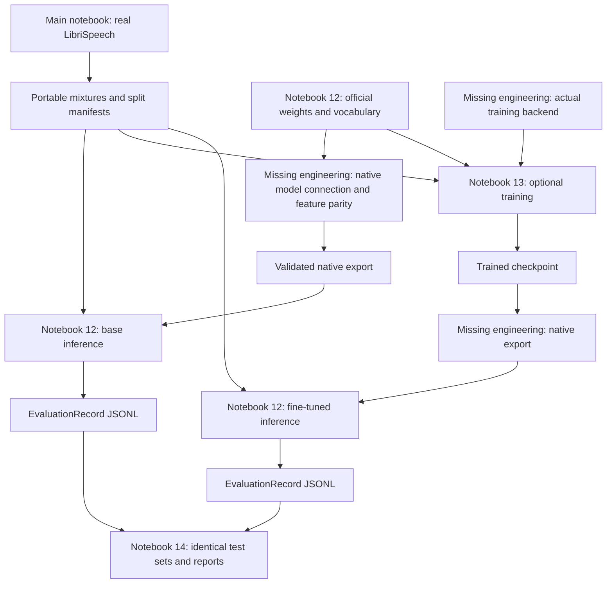

# Active artifact dependencies

WhisperRT, VAD and OSD outputs are not dependencies of SURT inference.
Data preparation and result-schema handoffs are executable. The native model
connection, feature/checkpoint parity, training backend and exporter remain
explicit implementation gaps. For a base-only study, omit training and report
only the actual base model results. See [the Persian guide](KAGGLE_WORKFLOW_FA.md).
