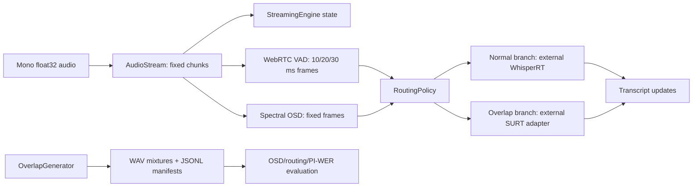

# Technical Review Report: English Streaming ASR with Overlapped Speech

**Review basis.** Static review of the tracked repository at Git revision `d0d7c407c991a604bbffb41ab27a4ebb5228adb9`, plus non-destructive local verification on 16 October 2026. Facts below are verified from code, configuration, committed documents, or commands listed in Section 8. “Assumption” denotes an interpretation not directly demonstrable from an executed model run.

## 1. Project overview

The repository is a Python research-engineering scaffold for English streaming automatic speech recognition (ASR) under two-speaker synthetic overlap. It provides: audio chunk representations; fixed-frame streaming VAD; a causal spectral-peak overlap-speech detector (OSD); deterministic mixture generation and manifests; adapters for an external WhisperRT streaming decoder and an external SURT-compatible multi-talker decoder; adaptive routing; training-data preparation; and metric/evaluation record infrastructure.

The repository is **not** an empirically validated end-to-end ASR system in this checkout. No audio datasets, generated manifests/audio, model checkpoints, or final per-example evaluation records are present. `README.md:5-8` and the Phase 10 documentation correctly describe full empirical reproduction as pending. The only documented numerical model result is a small synthetic Phase 5 heuristic-OSD demonstration (precision 1.000, recall 0.636, F1 0.778, mean detection delay 15 ms, RTF 0.00274); it is not a WhisperRT/SURT recognition result and was not reproduced here because its generated data are absent.

## 2. Structure and dependencies

### Repository inventory

| Area | Verified contents | Status |
| --- | --- | --- |
| Library | `src/streaming_asr/` with audio, datasets, models, streaming, pipelines, metrics, training, evaluation, utilities, and visualization modules | Present |
| Entry points | `scripts/` contains generation, VAD/OSD, adaptive, multi-talker, training, evaluation, audit, smoke-test, and notebook-validation commands | Present; some are stubs |
| Configuration | 12 YAML files in `configs/` | Present |
| Tests | 15 pytest modules in `tests/` | Present |
| Notebooks/docs | 14 notebooks plus phase reports and reproducibility documentation | Present |
| Data | `data/manifests/.gitkeep`, `data/samples/.gitkeep` only | No data assets committed |
| Checkpoints | `checkpoints/.gitkeep` only | No checkpoint assets committed |
| Outputs | committed audit JSON plus ignored output directories | No committed experimental predictions/metrics/logs |

Ignored/cached items encountered were `.git/`, `.pytest_cache/`, `scripts/__pycache__/`, `tests/__pycache__/`, `.DS_Store`, and the placeholder-only data/checkpoint/output directories. No virtual environment, large binary, model weight, WAV, manifest JSONL, or transcript corpus was found in the project tree.

### Languages, packaging, and dependencies

Python is the sole implementation language. The package uses a `src/` layout and Setuptools (`pyproject.toml:1-20`), requires Python >=3.10, and has core dependencies `numpy>=1.23` and `PyYAML>=6.0`. The development extra is pytest; optional extras are `soundfile`, Hugging Face `datasets`/`huggingface_hub`, and `webrtcvad-wheels` (`pyproject.toml:12-15`). `requirements.txt` and `environment.yml` retain only lightweight core dependencies; PyTorch, WhisperRT, SURT/Icefall, tokenizers, and model weights are intentionally not pinned or bundled.

Configured data are LibriSpeech through `openslr/librispeech_asr` (`configs/whisperrt_baseline.yaml:7-12`) and synthetic two-speaker mixtures under `outputs/synthetic_overlap` (`configs/overlap_dataset.yaml`). The supplied model identifiers are `MLSpeech/WhisperRT-Streaming`/`small_300.pt` and `SURT-2.0`, but neither backend/checkpoint is present or verified locally. The SURT configuration deliberately leaves `decoder_factory`/training `backend_factory` unset.

## 3. Architecture and components

`AudioStream.from_array` partitions mono `float32` arrays into non-overlapping chunks of `chunk_size` samples and assigns start/end timestamps (`src/streaming_asr/audio/stream.py:42-48`). The configured normal ASR chunk is 300 ms at 16 kHz (4,800 samples); the VAD/adaptive default is 320 ms (5,120 samples); VAD and OSD use 30 ms frames (480 samples). `AudioChunk` contains a one-dimensional array, sample rate, timestamps, and chunk index, but does not verify that timestamp duration equals `len(samples)/sample_rate`.

WhisperRT is an external stateful adapter. It requires 16 kHz input, creates a `SpectrogramStream`, invokes a state-resetting external model, and calls `model.decode` per input chunk (`src/streaming_asr/models/whisperrt.py:137-184`). The code uses the external encoder’s `gran` if supplied; otherwise it derives a nominal 20-ms-frame value from configured chunk duration. No token vocabulary, parameter count, feature-frame tensor shape, or checkpoint architecture can be established because the external runtime is unavailable.

VAD is either a test-only energy detector or WebRTC VAD (`src/streaming_asr/models/vad.py:90-183`). WebRTC input is buffered into allowed 10/20/30-ms PCM16 frames; a result reports whether any frame in each incoming audio chunk is speech. Partial frames are zero-padded once at finalization. This is buffering rather than endpointing: there is no configurable hangover, end-of-utterance event, or segmentation output queue.

Overlap handling is partial. The implemented deployable candidate is `SpectralHeuristicOSD`, a causal per-frame heuristic that declares overlap when the energy gate passes and two sufficiently separated spectral peaks are found (`src/streaming_asr/models/overlap_detector.py:83-170`). It neither separates sources nor diarizes speakers. Its “probability” is a bounded function of selected peak count, not a calibrated posterior. The multi-talker route is only an adapter contract: `SURT2WindowedASR` sends a rolling waveform window to a caller-provided decoder factory and normalizes returned streams (`src/streaming_asr/models/multitalker.py:105-204`). No SURT decoder, training graph, tokenizer, or checkpoint is included.

Adaptive routing combines VAD/OSD decisions with threshold/persistence controls (`src/streaming_asr/pipeline/adaptive.py:103-178`). In shared-branch mode, a single ASR branch receives all chunks; its logical route changes but ASR capability does not. In separate-branch mode a bounded history may be replayed to a newly used branch (`src/streaming_asr/pipeline/adaptive.py:293-318`). This preserves decoder context but adds no source separation. Look-ahead is only a parameter of the SURT rolling-window size; no future waveform is buffered before decoding, so configured positive look-ahead is not physically realized.

## 4. Pipeline and workflow

1. **Load or form audio.** `load_audio` reads with SoundFile when available, otherwise only PCM16 WAV via `wave`; it converts to mono (`src/streaming_asr/audio/loader.py:19-33`).
2. **Chunk audio.** `AudioStream.from_array` creates timestamped chunks (`src/streaming_asr/audio/stream.py:42-48`).
3. **Create overlap data (optional).** `OverlapGenerator.generate_dataset` uses a seeded NumPy generator, chooses two distinct-speaker source utterances, normalizes RMS, mixes them, peak-limits the result, writes PCM16 WAV, and writes a JSONL manifest (`src/streaming_asr/datasets/overlap_generator.py:47-115`; `scripts/generate_overlap.py:48-92`). Overlap ratio is overlap duration divided by the shorter source duration.
4. **Streaming analysis.** VAD and OSD append incoming chunks to internal buffers and emit aggregate per-chunk results after fixed-frame analysis (`src/streaming_asr/models/vad.py:139-174`; `src/streaming_asr/models/overlap_detector.py:135-163`).
5. **Recognition/routing.** Baseline/VAD pipelines forward continuous chunks to external ASR (`src/streaming_asr/pipeline/baseline.py:19-65`). Adaptive routing selects idle, normal, or overlap branches (`src/streaming_asr/pipeline/adaptive.py:181-281`).
6. **Decoding.** WhisperRT returns an external rolling text hypothesis. The SURT adapter decodes the latest context/chunk/look-ahead-sized waveform window and applies textual suffix de-duplication across stream updates (`src/streaming_asr/models/multitalker.py:151-189`).
7. **Scoring.** WER/CER normalize lower-case English alphanumeric/apostrophe text and use Levenshtein distance (`src/streaming_asr/metrics/asr.py:8-39`). PI-WER enumerates all stream permutations with empty stream padding (`src/streaming_asr/metrics/asr.py:49-67`). OSD labels use source-interval intersection and midpoint alignment (`src/streaming_asr/metrics/osd.py:18-79`).
8. **Aggregate/report.** Evaluation records can be weighted by supplied error/reference-unit counts; bootstrap intervals are deterministic from a seed (`src/streaming_asr/evaluation/evaluator.py:25-77`).

## 5. Training, inference, and evaluation

### Entry points and hyperparameters

The documented configuration commands are `python3 scripts/generate_overlap.py --demo`, `python3 scripts/run_vad.py`, `python3 scripts/evaluate_osd.py`, `python3 scripts/run_adaptive.py`, `python3 scripts/run_multitalker.py`, `python3 scripts/train_asr.py`, and `python3 scripts/evaluate.py`. Baseline execution is not available through its nominal entry point: `scripts/run_baseline.py:1` prints a Phase 0 “not implemented” message.

`configs/training.yaml` specifies three epochs, batch size 1, gradient accumulation 1, evaluation/checkpoint intervals of 50, and early stopping patience 3, but learning rate, warmup, decay, precision, checkpoint, and external training factory are null/not configured. Therefore it is a validation contract, not a runnable training recipe. The training script will only run after a version-pinned `model.backend_factory` is supplied (`scripts/train_asr.py:64-72`).

### Metrics and evidence

Implemented metrics include WER, corpus WER, CER, PI-WER, VAD/OSD/routing precision-recall-F1, signed OSD event delay, RTF, per-example aggregates, bootstrap intervals, and hardware/latency record fields. WER normalization and edit-distance implementation are internally coherent for English text. PI-WER is correct for the fixed small number of output channels it was designed for, but its factorial enumeration is not scalable to many streams.

No verified WhisperRT WER, overlap-ASR WER, PI-WER, final latency, endpoint latency, DER, SI-SDR, parameter count, loss curve, or fine-tuning result exists in this checkout. DER and SI-SDR are not implemented. Reported OSD demonstration values remain documentary evidence only; no matching local artifacts were found.

## 6. Bugs and defects

| ID | Severity | Location | Description | Fix |
| --- | --- | --- | --- | --- |
| B1 | Major | `scripts/run_baseline.py:1` | The advertised WhisperRT baseline command is a one-line Phase 0 stub, while the project documents Phase 1 baseline support. A supervisor/researcher cannot run the normal ASR benchmark through the intended entry point. | Implement the runner around `WhisperRTStreamingASR`, `StreamingASRBaselinePipeline`, dataset iteration, per-example predictions, and corpus WER/RTF/latency output; otherwise remove the execution claim. |
| B2 | Major | `src/streaming_asr/pipeline/streaming.py:39-46` | `StreamingASRPipeline.finalize()` finalizes VAD, OSD, and ASR but discards all three return values and returns only `StreamingState`. The final transcript/partial-frame decisions cannot be retrieved through this public pipeline API. | Return a structured final output containing component final results and engine state, matching `VADStreamingASRPipeline.finalize()`. |
| B3 | Major | `src/streaming_asr/audio/stream.py:19-25` | `AudioChunk` accepts arbitrary timestamps unrelated to sample count and accepts discontinuous chunk timing. Every buffer, latency calculation, source window, and routing event trusts those timestamps, permitting silent timestamp drift. | Validate duration against `len(samples)/sample_rate` within tolerance; enforce continuity in `StreamingEngine` or explicitly support/reset on gaps. |
| B4 | Major | `src/streaming_asr/models/multitalker.py:129-156` | The SURT adapter appends every chunk to `_buffer`; `_decode` merely slices a temporary tail window. Long-running streams therefore retain the entire waveform and grow memory without bound despite a bounded decoding context. | After decoding, retain only samples needed for context plus pending look-ahead, advance `_buffer_start`, and add a long-stream memory test. |
| B5 | Major | `src/streaming_asr/models/multitalker.py:133-160` | `lookahead_ms` increases `max_samples` but decoding occurs at the current `chunk.end_time`, before future audio exists. A configured nonzero look-ahead therefore is not actual algorithmic look-ahead and latency claims would be understated. | Buffer until `lookahead_ms` of future audio are available; decode at the corresponding delayed timestamp and report that delay. |
| B6 | Major | `src/streaming_asr/evaluation/evaluator.py:25-30` | Corpus aggregation switches to an unweighted mean if even one record lacks `error_count` or `reference_units`. Mixed complete/incomplete WER records can silently produce an invalid unweighted “corpus” score. | Reject mixed aggregation modes per metric/system/split, or separately report weighted and unweighted summaries with explicit labels. |
| B7 | Minor | `src/streaming_asr/models/vad.py:71-87` | VAD maintains only the current/latest speech segment. It does not emit completed segments at speech-to-silence transitions, so it cannot implement endpointing despite retaining segment state. | Add a completed-segment queue/event to `VADResult`, with configurable hangover/minimum-silence rules. |
| B8 | Minor | `src/streaming_asr/audio/preprocessing.py:6-12` | Mono conversion guesses channel orientation from whether dimension 1 is <=8. Valid short, multichannel frame-major arrays (for example 10 frames ×16 channels) are averaged over the wrong axis. | Define frame-major input explicitly, or accept an explicit channel axis and validate it at load boundaries. |

## 7. Incomplete parts and technical debt

The following are explicitly incomplete: real WhisperRT execution, SURT decoder implementation, model download/checkpoint provenance, trainable SURT backend, tokenizer/loss graph, OSD training (`scripts/train_osd.py:1`), dataset preparation (`scripts/prepare_dataset.py:1`), and baseline runner (B1). There is no diarization, speaker identification, source separation, beamforming, endpointing policy, actual positive look-ahead, DER, SI-SDR, final external-corpus evaluation, or pinned external ML environment.

Tests cover lifecycle/contract logic but do not cover timestamp consistency, long-duration buffer bounds, actual external backends, model/data download, end-to-end text correctness, or trained-model reproducibility. Notebook validation parses JSON only; it does not execute cells (`scripts/validate_notebooks.py:11-23`). Some documentation retains phase-history counts that differ from the current checkout (for example prior 11-notebook and 40-test references), so the generated report should be treated as historical, not current execution evidence.

## 8. Verification results

Commands run non-destructively in the supplied environment:

| Command | Result |
| --- | --- |
| `pytest -q` | `44 passed, 1 skipped` in 1.12 s |
| `python3 scripts/validate_notebooks.py` | `14/14 valid` |
| `python3 scripts/audit_artifact.py` | Passed: 173 audited files; no sensitive/large-file findings; required metadata present |
| `python3 scripts/smoke_test.py --phase 0` | Success; 3 chunks finalized |
| `python3 scripts/smoke_test.py --phase 3 --demo-overlap` | Success; deterministic overlap validation true |
| `python3 scripts/smoke_test.py --phase 8` | Success; training-contract smoke true |
| `python3 scripts/smoke_test.py --phase 9` | Success; evaluation-contract smoke true |
| `python3 scripts/smoke_test.py --phase 10` | Success; provenance-artifact smoke true |

The initial combined verification used `python`, which is not installed on PATH after pytest completed; rerunning all script checks with `python3` succeeded. No dependency installation, dataset download, or model download was attempted. External WhisperRT/SURT execution could not be run because the repository has no pinned/installable backend configuration, checkpoints, or data assets.

## 9. Assessment and recommendations

**Overall state: (b) extendable after fixing listed bugs.** The codebase is a coherent, tested scaffold with unusually clear limitations and useful reproducibility controls. It is not ready to claim a working overlap-aware ASR result, because its recognition branches depend on unprovided external implementations and core streaming correctness defects remain.

Priority actions before adding features:

1. Implement and test the baseline runner; establish a clean-speech WhisperRT reference result.
2. Fix B2-B5 and add tests for timestamp consistency, final output delivery, bounded memory, and measured look-ahead latency.
3. Pin one executable WhisperRT environment/checkpoint and one reproducible dataset manifest; record hashes and versions.
4. Generate split-disjoint real speech mixtures; retain manifests, source IDs, gain/overlap metadata, and generation seed.
5. Pin an official SURT/Icefall decoder, tokenizer, checkpoint, and training recipe; do not describe the adapter as a trained multi-talker model before this.
6. Define endpointing/VAD semantics and latency measurement protocol.
7. Fix B6 and validate scoring with known WER/PI-WER fixtures; make aggregation modes explicit.
8. Compare clean, single-stream overlap, heuristic-OSD routing, oracle routing, and multi-talker systems on the identical protected test set.
9. Add external/real-overlap evaluation and report uncertainty, failures, hardware, and real-time factor.
10. Synchronize README/phase claims with runnable scripts and current test/notebook counts.

## 10. Questions for the supervisor

1. Which dataset(s) are acceptable for the primary claim: LibriSpeech-derived synthetic mixtures only, Libri2Mix/LibriSpeechMix, and/or a real meeting corpus such as LibriCSS?
2. Is the target research question overlap detection/routing, multi-talker transcription, or both? This determines whether a heuristic OSD is a baseline or an insufficient core method.
3. What latency budget is required, and does it permit actual future-audio look-ahead?
4. What overlap-ratio, gain/SNR, number-of-speaker, and speaker-disjointness protocol is required?
5. Which external WhisperRT/SURT implementation and checkpoint are approved as the reproducible baseline/candidate?
6. Should evaluation use channel-permutation WER only, or require speaker-attributed scoring/diarization as well?
7. Is fine-tuning required for the academic objective, and what compute/data governance resources are available?

## 11. Appendix: files reviewed

Reviewed in full or directly traced: all Python files under `src/streaming_asr/`, all Python files under `scripts/`, all pytest modules under `tests/`, `README.md`, `pyproject.toml`, `requirements.txt`, `environment.yml`, all YAML files under `configs/`, all notebook JSON under `notebooks/`, `outputs/audit/project_audit.json`, and the phase/reproducibility documentation under `docs/` relevant to Phases 5-10. Repository inventory also included data, checkpoint, output, and cache directory contents described in Section 2.
