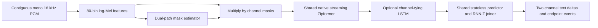

# Stage 2: Continuous SURT 2.0 streaming refactor

Date: 23 October 2026. Scope: the current working tree, following
`docs/stages/stage1_report.md` (B1–B8).

## 1. Status and evidence boundary

The heuristic routing implementation and rolling waveform SURT adapter have
been removed. The repository now provides a continuous feature scheduler,
structured PyTorch SURT inference composition, export-bundle loader, endpoint
outputs, working inference commands, and regression tests for the stage1 bugs.

**This checkout does not contain trained SURT weights, a tokenizer, an official
recipe checkout, or native DPRNN/Zipformer exports. PyTorch is not installed in
the local verification environment.** The model-free tests pass; tensor-level
composition tests, feature parity against torchaudio, and trained-model
integration are skipped when their dependencies/assets are unavailable. No
recognition accuracy, trained-model cache bound, GPU memory measurement or
production latency result is claimed. Implementing a recipe-specific native
export and validating its features remain prerequisites to using an existing
official checkpoint. The loader does not convert an offline checkpoint into a
streaming model automatically.

## 2. Architecture and official reference

The design follows Raj, Povey and Khudanpur, *SURT 2.0: Advances in
Transducer-based Multi-talker Speech Recognition*, 2023, especially Sections
IV-A/IV-B and V-C, and the official icefall LibriCSS SURT model implementation.

The important ordering is masking **before** recognition. An 80-dimensional
log-Mel sequence is multiplied by the dual-path network's channel masks.
The resulting channels use shared encoder, predictor and joiner parameters.
The paper uses a chunk-local bidirectional intra-LSTM, recurrent inter-chunk
modeling, a causal Zipformer, a stateless Conv1D predictor, and an optional
branch-tying LSTM across channels. Its 32-frame chunk corresponds to a stated
320 ms modeling latency.



All audio, including silence and single-speaker speech, reaches the same
recognizer. VAD and OSD are optional observers in the generic pipeline; they
cannot select another model, skip audio or replay history. Output channel IDs
are not enrolled speaker identities. More than two sequential speakers are
possible, but this configuration supports at most two simultaneous channels.

The original HEAT channel assignment in training is unrelated to the removed
runtime router. Training losses, pre-training, mixture generation and
adaptation are not implemented by an inference wrapper and remain the
responsibility of the selected trained recipe.

Reference identifiers:

- Paper: `https://arxiv.org/abs/2306.10559`, version 2, 19 September 2023.
- Official model: `https://github.com/k2-fsa/icefall/blob/master/egs/libricss/SURT/dprnn_zipformer/model.py`.
- Feature convention comparison: `https://github.com/lhotse-speech/lhotse/blob/master/lhotse/features/kaldi/extractors.py`.

These references were inspected during the refactor. Their moving branch URLs
are references, not a pinned runtime dependency or proof of checkpoint parity.
A deployed bundle must record its own exact recipe commit and artifact hashes.

## 3. Code organization and backend contract

| File | Responsibility |
| --- | --- |
| `audio/stream.py` | Lazy chunk iteration, integer sample positions, PCM16 conversion and timestamp validation |
| `audio/preprocessing.py` | Explicit channel axis and frame-major default |
| `audio/features.py` | Bounded 80-bin streaming filterbank, deterministic EOF policy |
| `models/multitalker.py` | `SURTBackend`, `BackendOutput`, fixed-frame scheduling, endpoint events and idempotent EOF |
| `models/torch_surt.py` | `TorchSURTBackend`, feature masking, shared encoder, optional branch tying, greedy RNN-T and export loader |
| `pipeline/streaming.py` | Continuous forwarding and structured component final results |
| `streaming/engine.py` | Sample continuity and fixed-rate enforcement |
| `evaluation/evaluator.py` | Strict aggregation modes and zero-reference insertion accounting |
| `scripts/run_multitalker.py` | Single-file inference or manifest evaluation with corpus PI-WER |

Paths in the first eight rows are relative to `src/streaming_asr/`.

A native backend declares `num_channels=2`, `chunk_frames=32`,
`frame_shift_samples=160`, `right_context_frames` (0 or 1), and a positive
`max_state_bytes`. It implements:

```python
reset() -> None
step(features, *, valid_frames, final) -> BackendOutput
finish() -> BackendOutput
```

`features` is float32 `[32 + right_context_frames, 80]`. Only the first
`valid_frames <= 32` frames advance state; any extra context frames are peeked
and supplied again with the next chunk. `BackendOutput` has exactly two new
text deltas and two trailing-blank counts measured in 10 ms input-frame units.
Blank counters may span chunks. Configuration values must match the loaded
model's declared chunk/context settings. Exceptions propagate; no fallback
recognizer masks model errors.

The supplied PyTorch composition expects actual trained streaming modules:

- Mask estimator: `initial_state()` and
  `forward_chunk(x, state, valid_frames, final) -> (masks, state)`;
  input `[1,W,80]`, output masks `[1,W,160]` in feature/channel order.
- Encoder: the same stateful call returning `(encoded, lengths, state)`;
  input `[2,W,80]`, output `[2,T,D]`. Lengths exclude padded frames and peeked
  context. Every call emits all valid current outputs; these exports must not
  conceal another delayed acoustic tail.
- Stateless predictor: `decoder(context, need_pad=False)` with fixed token
  context, and an icefall-style joiner accepting encoder/predictor tensors.
- Optional branch-tying LSTM: recurs over the two channel positions separately
  for each encoded time index, without adding future temporal context.

The composer uses `eval()` and `torch.inference_mode()`, preserves acoustic
states and separate channel token histories, and decodes with bounded greedy
RNN-T expansion (default four nonblank emissions per encoder frame). It uses
no manually weighted sequence scores. Encoder subsampling converts blank
counts to input-frame units. Tokenizer decoding occurs on endpoint/EOF commits
to avoid corrupting BPE word boundaries by independently decoding tiny token
pieces. This policy adds endpoint waiting to text delivery; it does not offer
unstable partial text. Greedy limits and subsampling must match the selected
export's decoding policy.

## 4. Bug resolutions

| ID | Resolution | Regression evidence |
| --- | --- | --- |
| B1 | `run_baseline.py` now executes the existing independent WhisperRT dataset benchmark. `run_streaming.py` executes SURT; `run_adaptive.py` delegates to the same SURT command. Baseline accumulation incorporates the final returned hypothesis. | CLI help checks; subprocess SURT file-inference test with an explicitly synthetic backend |
| B2 | `PipelineFinalOutput` retains VAD, OSD, ASR and engine results. SURT flushes feature tails, padded final model blocks and backend output, including streams shorter than one chunk and exact block boundaries. Repeated finalization returns the same result. | All component tails returned once; input lengths 0, 1, 159, 160, 399, 400, 5119, 5120, 5360 and 10241 samples; EOF text delta retained by runner |
| B3 | Timestamp durations and sample-grid alignment are checked. `start_sample`/`end_sample` derive integer positions; the engine requires contiguous input from sample zero at a fixed rate. Feature and consumed-frame counters use integers. | Duration mismatch, off-grid timestamps, gaps and rate changes rejected |
| B4 | No recording-length waveform buffer exists in SURT. Incoming blocks are processed in at most 5120-sample slices; feature windows advance by 160 samples; consumed feature blocks are copied out and released. Torch acoustic caches are checked against an explicit storage budget. | 2000 successive 5120-sample calls (640 seconds of synthetic silence) maintain bounded PCM and feature queues |
| B5 | Default uses chunk-local future information only. Optional one-frame explicit context is physically awaited; it is not an enlarged historical window. Padding future context is allowed only at EOF. | At 5360 samples the extra-context model has not decoded; at 5520 samples it has one actual 33-frame window |
| B6 | Mixed or incomplete count-based aggregation raises an error. Complete records use total errors divided by total reference units; zero-reference insertions remain in the numerator. The SURT runner aggregates integer PI-WER errors/reference words, not utterance scores or manual weights. | Unequal-reference corpus fixture, mixed/incomplete records, zero-reference insertions |
| B7 | SURT exposes per-channel blank-silence endpoints, once per active channel, without acoustic reset or silence dropping. Independent VAD now emits `completed_segments` with configurable minimum silence, per-frame WebRTC transitions and EOF closure. | Single endpoint event with continuous model state; VAD short-pause hangover, completed segment and final open-segment tests |
| B8 | Two-dimensional input is explicitly frame-major by default (`channel_axis=1`), with channels-first opt-in. Signed PCM16 is normalized before averaging. Nonfinite input, unsupported integer formats and unsupported fallback WAV widths are rejected. | 10-frame × 16-channel PCM16 fixture, channels-first fixture and exact sample count |

For count-based groups with no total reference units, the evaluator returns
zero if there are no errors and infinity if there are insertions. The runner
reports corpus PI-WER as null when its entire selected corpus has zero
reference words, retaining raw counts. Neither result is an ordinary finite
WER suitable for comparison.

## 5. Streaming and benchmarking parameters

| Parameter | Value / policy |
| --- | --- |
| Input | Mono normalized float32 or signed PCM16, 16000 Hz; explicit offline resampling required for other rates |
| Features | 80 bins; 400-sample/25 ms Povey window; 160-sample/10 ms shift; 512-point power FFT; 20–7600 Hz |
| Feature processing | DC removal, preemphasis 0.97, no dither, no energy coefficient; normalized waveform scaled by 32768 for this profile |
| Feature framing | Complete snipped windows during streaming; EOF zero-pads each remaining window whose start is within real audio |
| Model advance | Exactly 32 new frames (320 ms), except a final block with explicit valid length |
| Explicit extra context | Default 0; optional 1 frame (10 ms), physically buffered |
| Modeling context | 31 intra-chunk future frame offsets plus at most one extra frame: at most 320 ms; the nominal chunk latency is 320 ms |
| Acquisition overhead | First complete 32-frame window needs 5360 samples = 335 ms; extra-context window needs 5520 samples = 345 ms |
| Input delivery | CLI supplies 5120-sample chunks; this delivery cadence may add a further wait until the next callback |
| Endpoint silence | Default 800 ms of transducer blanks, quantized by encoder frame rate and chunk delivery |
| Text delivery | Stable deltas committed at endpoint/EOF; endpoint delay is additional to modeling/acquisition/compute latency |
| PCM queue | Less than 400 samples after an accept call; wrapper slices prevent recording-size temporary feature extraction |
| Feature queue | Less than 32 + explicit-context frames after draining; transient queue at most 64 frames for the supported input slicing |
| Acoustic cache | Default Torch composition budget 64 MiB; export loader takes its explicit metadata budget |
| Token state | Fixed predictor context per channel; pending endpoint tokens capped at 8192 per channel by default, with a clear error at overflow |

The PCM queue is at most 1596 bytes and the persistent feature queue is at
most 10240 bytes with one explicit context frame. Transient feature arrays,
FFT workspaces, model parameters, emitted results and allocator reservations
are additional. Cache checks count backing tensor storage, container overhead
and scalar state; they are conservative when tensors share storage. They
cannot inspect hidden state stored inside a custom external module. A backend
must therefore be audited and profiled, not merely declare a cache budget.

The file runner retains transcripts and per-record output for evaluation;
those naturally grow with output size. The bounded-memory claim concerns
acoustic history and decoder state, not a whole evaluation dataset or a
caller's retained output list. `AudioStream` creates chunks lazily, although
file loading still loads the source file into memory.

**Feature compatibility is explicit.** The export loader requires profile
`kaldi80-snip-pcm16-v1`. Official recipe variants may use normalized waveform
amplitudes and non-snipped/reflected framing. A raw pretrained checkpoint
must not be assumed compatible with this profile. Validate numerical features
and streaming/offline hypotheses for the pinned recipe, or supply a backend
and matching feature implementation before deployment. The optional torchaudio
parity test checks this implemented profile, not every Lhotse configuration.

For a real benchmark, record artifact hashes, recipe commit, feature profile,
chunk/context settings, decoder limits, endpoint settings, device, warm-up,
per-call p50/p95/p99 times, RTF and long-duration CPU/GPU memory. Compare
identical protected recordings and corpus PI-WER counts. The runner reports
unpaced processing time separately from available-sample acquisition positions;
its wall-clock first-output processing time is not a microphone end-to-end
latency measurement. Model load and file I/O are excluded from reported RTF.

## 6. Running inference

### Lightweight verification

```bash
python3 -m pip install -e ".[dev]"
pytest -q
python3 -m compileall -q src scripts
python3 scripts/smoke_test.py --phase 0
python3 scripts/validate_notebooks.py
```

### Trained export setup

Install the optional tensor/tokenizer stack in the intended inference
environment (the accelerator-specific PyTorch build must match that system):

```bash
python3 -m pip install -e ".[surt,audio]"
```

Create a trusted export directory containing `mask.pt`, `encoder.pt`,
`decoder.pt`, `joiner.pt`, `tokenizer.model`, and `metadata.json`. Add
`branch_tying.pt` when applicable. These are **native streaming exports with
the contracts in Section 3**, not renamed ordinary icefall state dictionaries.
An illustrative metadata file is:

```json
{
  "architecture": "surt2-dprnn-zipformer-stateless",
  "feature_profile": "kaldi80-snip-pcm16-v1",
  "blank_id": 0,
  "context_size": 2,
  "right_context_frames": 0,
  "encoder_subsampling": 4,
  "max_state_bytes": 67108864,
  "branch_tying": true
}
```

The vocabulary, blank ID, dimensions and subsampling are examples: use the
actual trained checkpoint's values. Keep bundle provenance and validation
results alongside the bundle. Then create `surt_override.yaml`:

```yaml
model:
  backend_factory: streaming_asr.models.torch_surt:load_torchscript_backend
  checkpoint: /absolute/path/to/validated/surt-export
  device: cpu
  endpoint_silence_ms: 800
```

Alternatively provide a `module:factory` returning a validated native
`SURTBackend`. Its responsibility includes loading matching weights and
implementing actual streaming state; a callable accepting waveform windows is
no longer accepted.

```bash
# Continuous unsegmented file transcription; prints two transcripts and events.
python3 scripts/run_streaming.py --audio meeting.wav --override surt_override.yaml

# Evaluate source transcripts from an existing overlap manifest.
# Set data.manifest in the override to the desired JSONL.
python3 scripts/run_multitalker.py --override surt_override.yaml --max-samples 10

# Check input paths/manifest without claiming model execution.
python3 scripts/run_multitalker.py --override surt_override.yaml --validate-only

# Independent single-speaker baseline; requires its own external runtime/assets.
python3 scripts/run_baseline.py --config configs/whisperrt_baseline.yaml
```

Manifest inference writes per-record JSONL and aggregate JSON through the
existing project output paths. Single-file inference prints its result JSON.
Training is still managed by the existing external training contract; this
change does not train or download a model.

## 7. Verification results

Verification in the supplied Python environment:

| Check | Result |
| --- | --- |
| `pytest -q` | 59 passed, 3 skipped in 6.16 seconds |
| `python3 -m compileall -q src scripts` | Passed |
| `python3 scripts/smoke_test.py --phase 0` | Passed, 3 chunks finalized |
| `python3 scripts/validate_notebooks.py` | 14/14 valid JSON; notebook code was not executed |
| `run_streaming.py`, `run_adaptive.py`, `run_baseline.py --help` | CLI parsers run successfully |
| `git diff --check` | Passed |

The three skipped test areas are: trained-model integration (no configured
assets), the optional PyTorch composition module (PyTorch absent), and
numerical torchaudio parity (PyTorch/torchaudio absent). Deterministic test
backends validate orchestration only and are explicitly not speech models.

For a real integration run:

```bash
STREAMING_ASR_RUN_SURT_INTEGRATION=1 \
STREAMING_ASR_SURT_OVERRIDE=/absolute/path/to/surt_override.yaml \
pytest -q -m integration
```

This checks configured execution and output schema. Deployment additionally
requires nonempty reference speech, offline/streaming equivalence checks,
causality checks, channel leakage/omission evaluation, and long-duration
real-backend memory/latency profiling. Those are not substituted by mock tests.

## 8. API migration and remaining limits

- Replace `SURT2WindowedASR` and `decoder_factory` with
  `SURT2StreamingASR` and `backend_factory`.
- `RoutingPolicy`, branch switching, fallback routing and history replay are
  removed. `AdaptivePipeline`/`AdaptiveStreamingASRPipeline` are import aliases
  for `StreamingASRPipeline`; call with `asr=...`. Old routing arguments and
  branch interfaces are unsupported. Historical trace enums live under
  `metrics/routing_types.py` only for old trace analysis.
- `MultiTalkerStream.text`/`new_text` now contain committed deltas, not a rolling
  full transcript. Collect them per channel; the runner demonstrates this.
- `StreamingASRPipeline.finalize()` returns `PipelineFinalOutput`; use `.state`
  for engine metadata and `.asr`, `.vad`, `.overlap` for final component output.
- Explicit gaps are rejected; start a fresh stream to represent discontinuity.
- Earlier phase reports, routing plots and notebooks are historical artifacts.
  They do not establish compatibility with the removed routing APIs.
- The optional branch-tying layer and actual DPRNN/Zipformer implementations
  come from a matching native export. The repository does not manufacture
  trained networks from unrecognized tensors, promise arbitrary checkpoint
  compatibility, or claim measured ASR performance without executing them.
